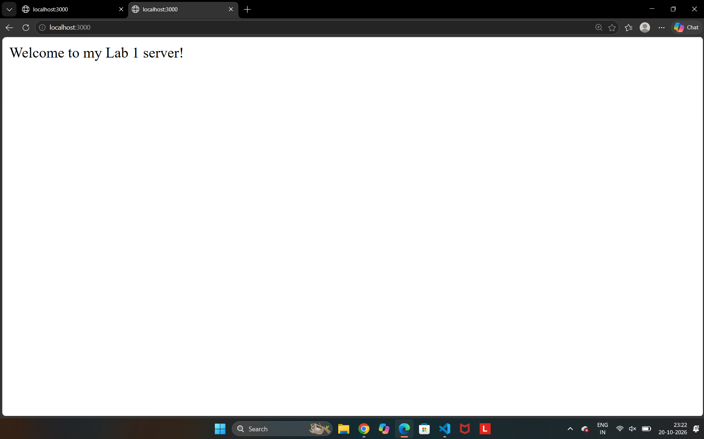
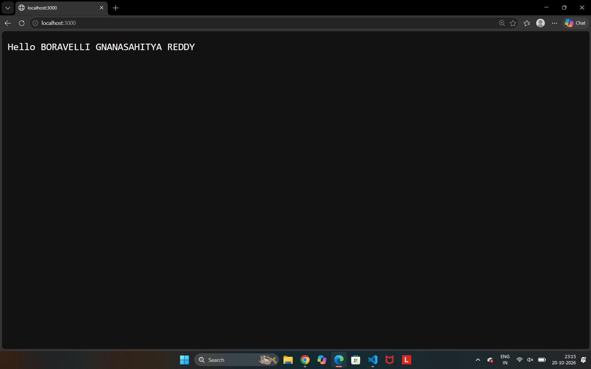
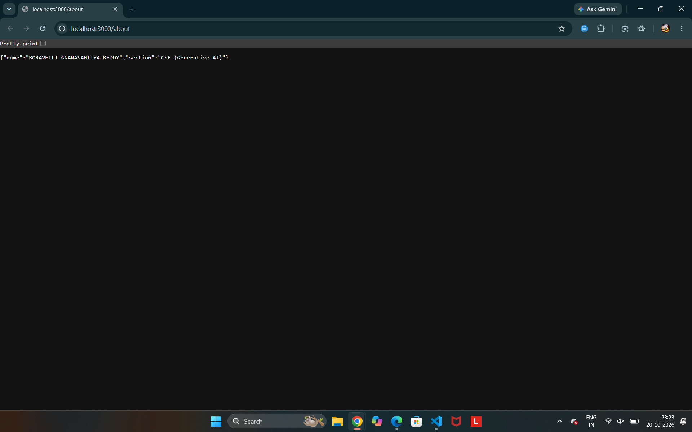
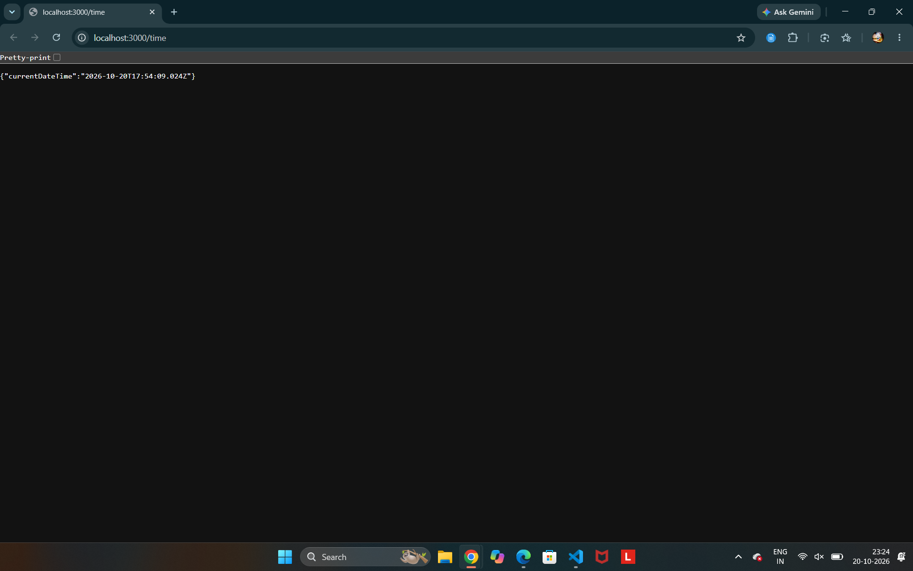
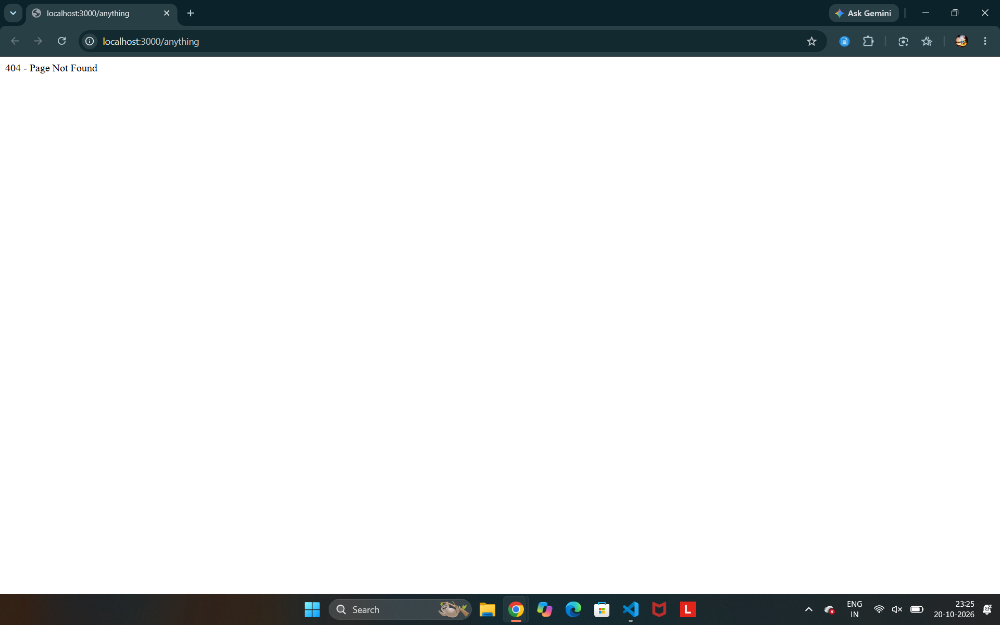

# Lab 1: Node.js and Express Server

## Student Details

- **Name:** BORAVELLI GNANASAHITYA REDDY
- **Registration Number:** 252U1R9021
- **Section:** CSE(GEN-AI) & 2A
- **Course:** Backend Development Fundamentals
- **Lab Number:** 01

## Live Link

Deployment URL will be added after the Render service is created.

## Objective

To create a basic HTTP server using Node.js and build an Express server with multiple GET routes and appropriate HTTP status codes.

## Technologies Used

- Node.js
- Express.js
- JavaScript
- npm
- Visual Studio Code

## Project Structure

```text
lab-01/
├── screenshots/
│   ├── http-server.png
│   ├── home.png
│   ├── about.png
│   ├── time.png
│   └── not-found.png
├── server-http.js
├── server.js
├── package.json
├── package-lock.json
├── .gitignore
└── README.md
```

## Installation and Setup

### Prerequisites

- Node.js and npm installed
- Visual Studio Code or another code editor

### Steps to Run

1. Open the project folder in the terminal.
2. Install the dependencies:

   ```bash
   npm install
   ```

3. Start the Express server:

   ```bash
   node server.js
   ```

4. Open `http://localhost:3000` in a browser.

### Run the Basic HTTP Server

To run the server using Node.js's built-in HTTP module:

```bash
node server-http.js
```

Stop one server before starting the other if both use port 3000.

## Deployment

The project includes a Render Blueprint in `render.yaml`. To deploy it, create a
new Blueprint Instance in Render and connect the `reddyboravelli3-git/Lab---01`
GitHub repository. Render will install dependencies with `npm ci` and start the
Express app with `npm start`.

## Endpoints

| Method | Endpoint | Description | Expected Status |
|---|---|---|---|
| GET | `/` | Returns a welcome message | 200 OK |
| GET | `/about` | Returns student details in JSON | 200 OK |
| GET | `/time` | Returns the current date and time | 200 OK |
| GET | `/anything` | Demonstrates an unknown route | 404 Not Found |

## Screenshots

### 1. Basic Node.js HTTP Server



### 2. Home Route



### 3. About Route



### 4. Time Route



### 5. Unknown Route



## HTTP Status Codes

- **200 OK:** The request was successful.
- **404 Not Found:** The requested route does not exist.

## Viva Questions

### 1. What is the difference between package.json and node_modules?

`package.json` contains project metadata, scripts, and dependency information. `node_modules` contains the installed packages.

### 2. What does app.listen() do?

It starts the Express server and listens for incoming requests on the specified port.

### 3. What do request and response represent?

`req` contains information about the incoming request. `res` is used to send data and status codes back to the client.

## Problems Faced and Solutions

During the lab, I verified that Node.js and Express were installed correctly. I tested the HTTP server and the Express routes in a browser. I checked the response for each route and confirmed that the unknown route returned a 404 response.

## Conclusion

This lab helped me understand how to create a basic HTTP server using Node.js and how to build an Express server with multiple GET routes. I learned how to return text and JSON responses, use HTTP status codes, and handle unknown routes.
